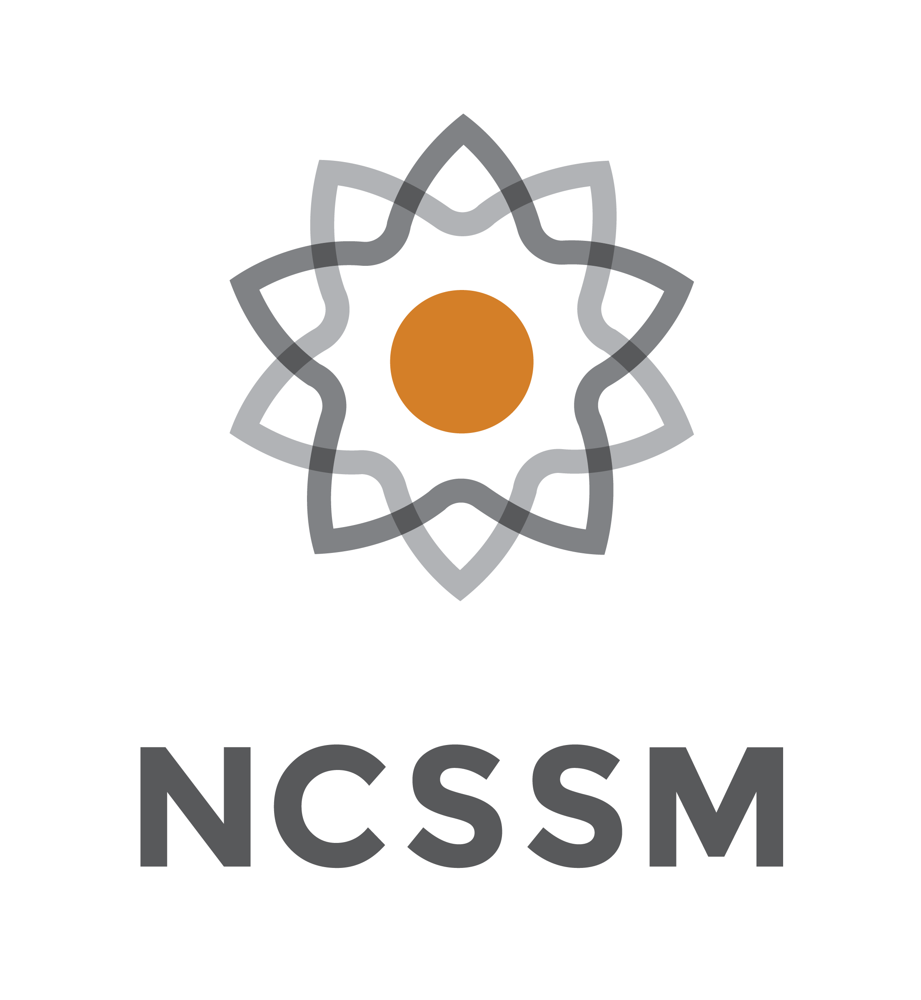
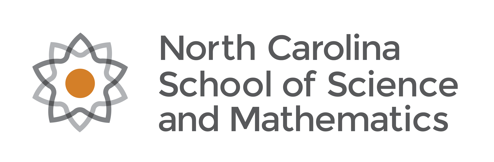
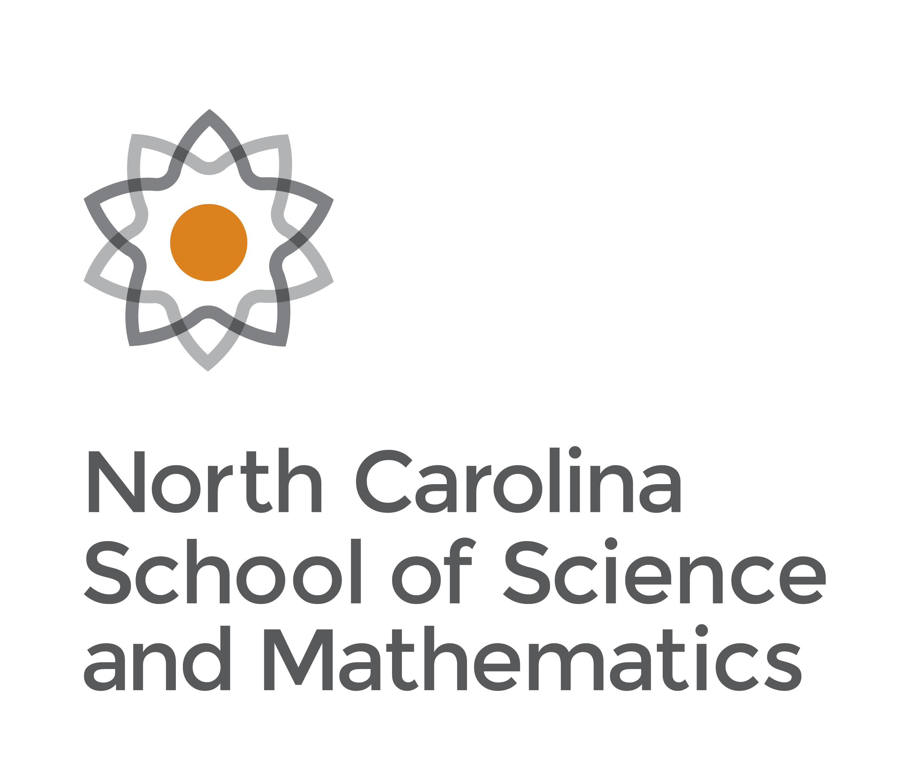
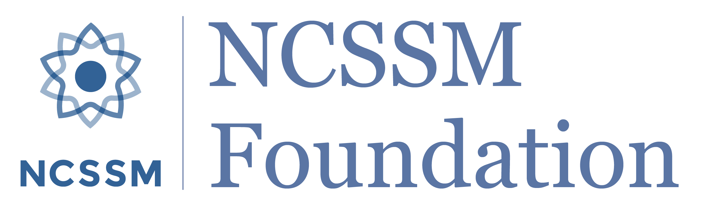
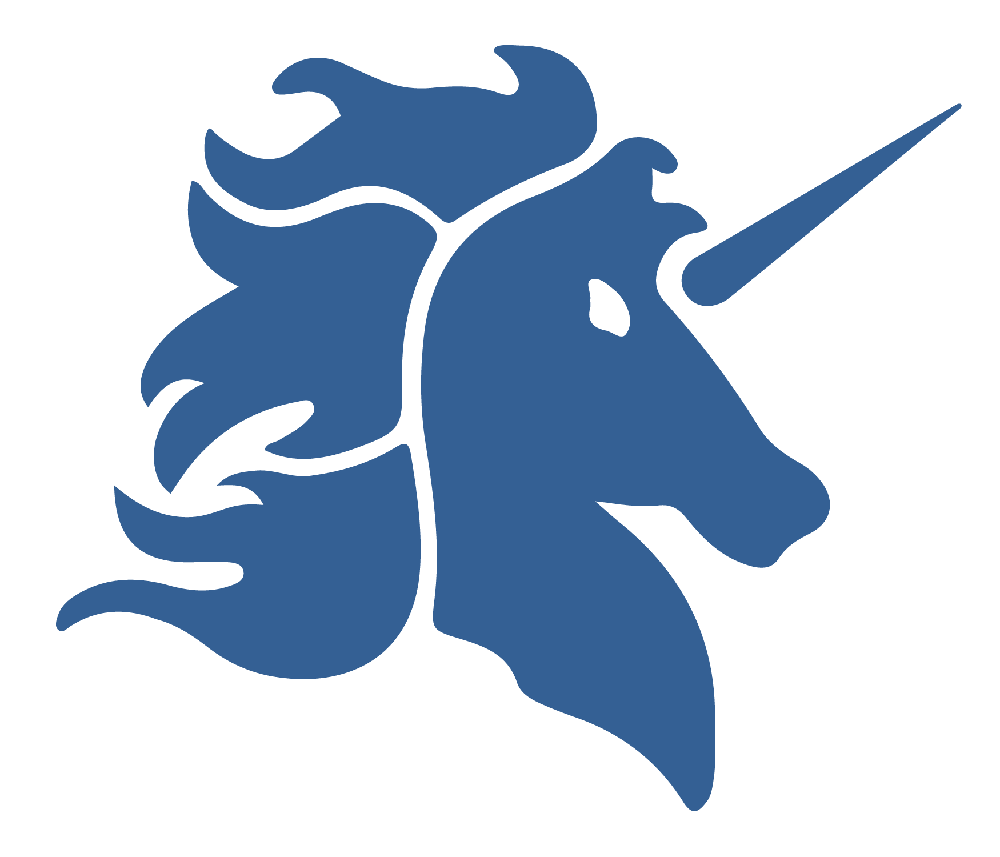
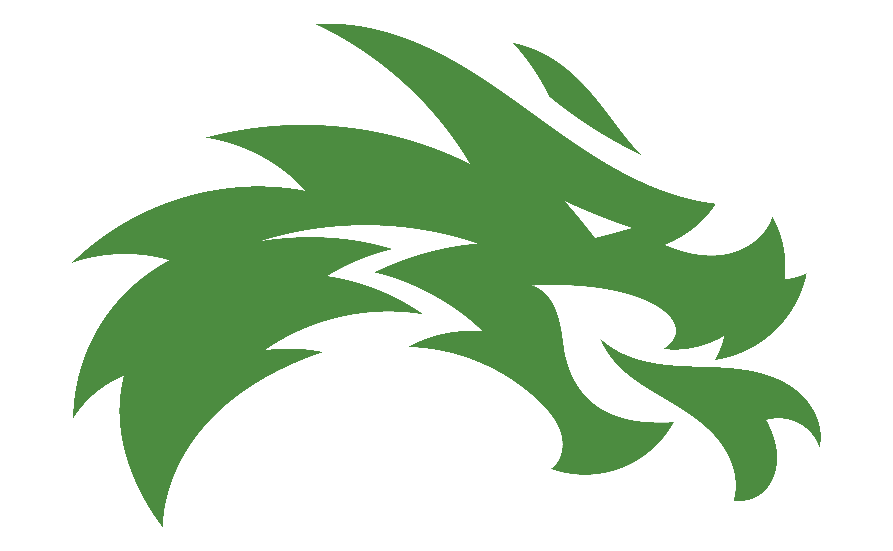

# NCSSM marks

The school's own logos, for when a YAC piece needs to show it's NCSSM's: the catalyst logos, the NCSSM Foundation logo and the two campus mascots. These are NCSSM's master files, copied unchanged from the YAC Brand Assets folder in Google Drive. NCSSM Communications owns them; we don't edit or redraw them.

The YAC's own logo isn't settled yet and isn't in this repo.

## Quick start

| I need… | Use |
| --- | --- |
| The NCSSM logo on a web page or slide | `svg/ncssm-horizontal-fullcolor.svg` (or the PNG) |
| The NCSSM logo on print, or where a taller logo fits better | `svg/ncssm-stacked-fullcolor.svg` (or the PNG) |
| The catalyst on its own (a small square space, apparel, a closing slide) | `svg/ncssm-abbreviated-fullcolor.svg` (or the PNG) |
| The Foundation logo on a light background | `png/ncssm-foundation-blue.png` |
| The Foundation logo on Blue or a photo | `png/ncssm-foundation-white.png` |
| Durham school spirit | `png/durham-unicorn-blue.png` |
| Morganton school spirit | `png/morganton-dragon-head-green.png` |
| Print (CMYK EPS, PDF, JPG), grayscale or reversed versions | Linked from the *NCSSM Brand Basics* deck in Drive, or the [NCSSM Communications Kiosk](https://sites.google.com/ncssm.edu/commskiosk/brand-logos); add them here when needed |

## The marks

| | File | What it is | Size |
| --- | --- | --- | --- |
|  | `ncssm-horizontal-fullcolor.png` | Horizontal logo: catalyst plus "North Carolina School of Science and Mathematics" | 4546 × 1500 |
|  | `ncssm-stacked-fullcolor.png` | Stacked logo: catalyst above the school's full name | 2813 × 2400 |
|  | `ncssm-abbreviated-fullcolor.png` | Abbreviated logo: catalyst over "NCSSM" | 2211 × 2400 |
|  | `ncssm-foundation-blue.png` | NCSSM Foundation logo, Blue, transparent background | 2550 × 751 |
|  | `ncssm-foundation-white.png` | NCSSM Foundation logo, white, transparent background (shows white-on-white here) | 2550 × 750 |
|  | `durham-unicorn-blue.png` | Unicorn: NCSSM-Durham athletics mascot | 1750 × 1500 |
|  | `morganton-dragon-head-green.png` | Dragon head: NCSSM-Morganton athletics mascot | 6250 × 3860 |

All are RGB with transparent backgrounds, for screens. The three NCSSM logos also come as SVG in `svg/` (same names); prefer those wherever SVG works, since they stay sharp at any size. For print, use the CMYK files linked from the Brand Basics deck.

## Which one to use

From NCSSM's guide:

- **The catalyst is NCSSM's official mark.** It's the default with any outside audience, and it's required with the Residential and Online programmes.
- **Horizontal** for most web and slide use. **Stacked** for most print. **Abbreviated** for apparel, promo items, or after the full logo has already appeared in a multi-page piece.
- **Full colour** whenever possible. Use grayscale or reversed (white) only when printing or the background demands it.
- **The Unicorn and Dragon are athletics mascots.** They can also be used for campus-specific things like clubs, apparel and school spirit, but not as the school's logo.

## Rules

**Do**
- Use these master files as they are. If you need a version that isn't here, download it from the Kiosk; don't make it yourself.
- Give the logo room: at least the height of the catalyst as clear space on every side.
- Put the full-colour logo on Paper or White. Use a reversed (white) version on Blue or Midnight.

**Don't**
- Separate the catalyst from the school's name. There is no catalyst-only file on purpose; use the abbreviated logo.
- Stretch, recolour, rotate, outline or add effects to any mark.
- Put the Unicorn or Dragon where the school's logo belongs, or use one campus's mascot for the other campus.
- Pair an NCSSM mark with an unofficial YAC logo concept until the YAC logo is settled.
- Mix these marks into Yakkety. Yakkety is the YAC's AI secretary, not an NCSSM mascot.

## Where the files came from

Google Drive › YAC › Brand Assets › Logos. Original file names:

| Here | In Drive |
| --- | --- |
| `ncssm-horizontal-fullcolor.png` | `horizontal_fullcolor_rgb.png` |
| `ncssm-abbreviated-fullcolor.png` | `abbreviated_fullcolor_rgb.png` |
| `ncssm-foundation-blue.png` | `NCSSM Foundation logo blue_transparent (2) (1).png` |
| `ncssm-foundation-white.png` | `NCSSM Foundation logo white_transparent (1) (1).png` |
| `durham-unicorn-blue.png` | `DUR Unicorn_blue_rgb.png` |
| `morganton-dragon-head-green.png` | `NCSSM _ Dragon Logo_Head_Green.png` |

The SVGs and the stacked PNG came from the logo links in the *NCSSM Brand Basics* deck (Google Slides, from NCSSM Communications): `stacked_fullcolor_rgb.svg`/`.png`, `horizontal_fullcolor_rgb.svg`, `abbreviated_fullcolor_rgb.svg`. Its horizontal and abbreviated PNGs are byte-identical to the ones above.

Usage guidance is from the Kiosk's *Brand & Logos* page (saved in Drive as "Branding Kit PDF Overview"). Questions about NCSSM marks go to communications@ncssm.edu.
