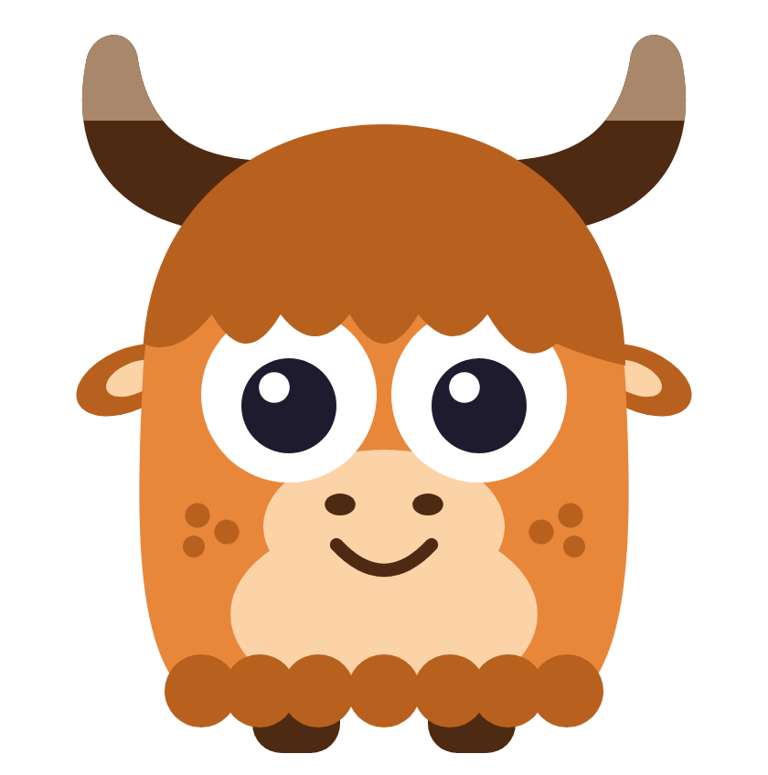
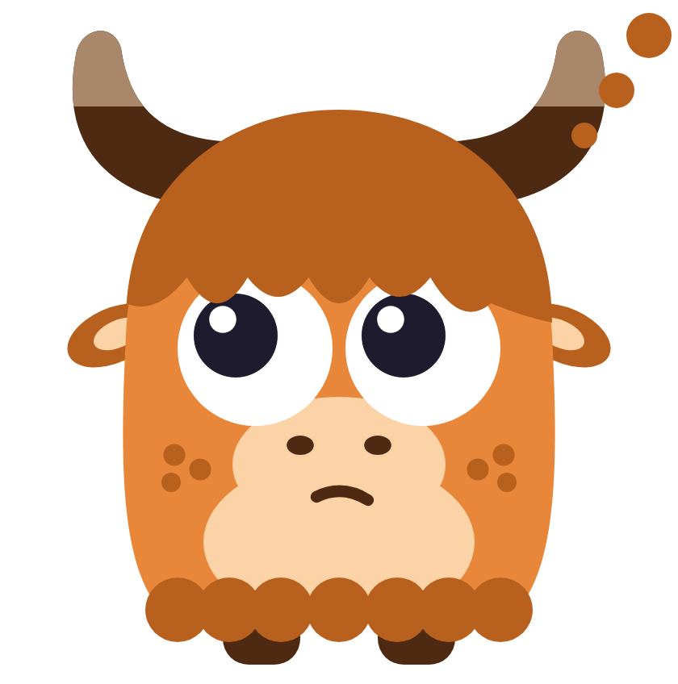
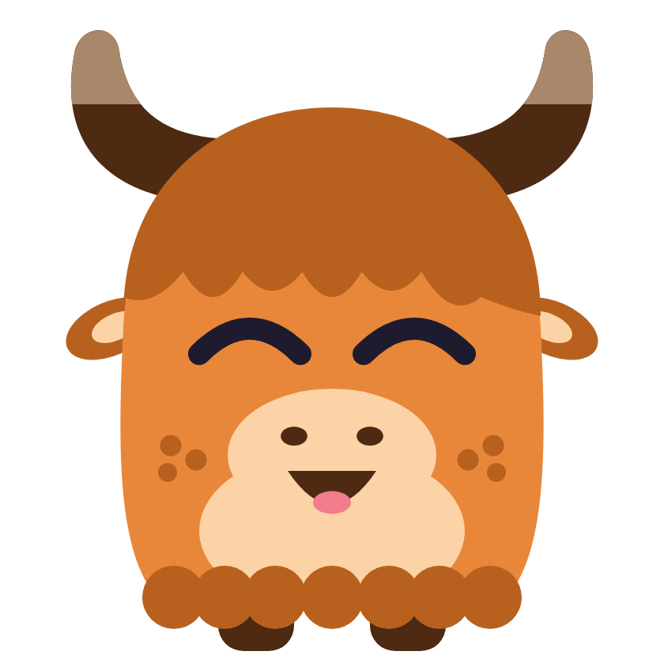
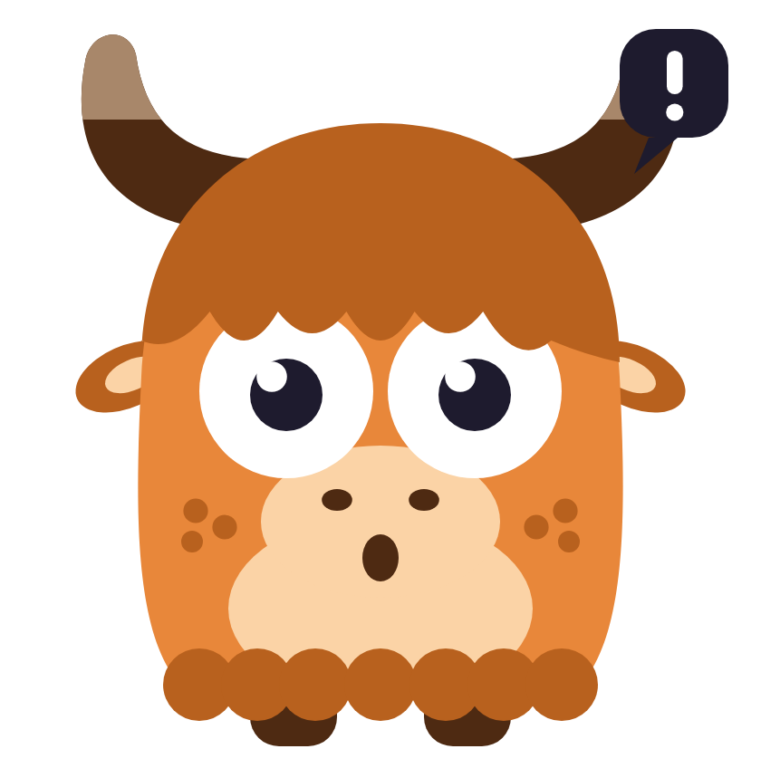
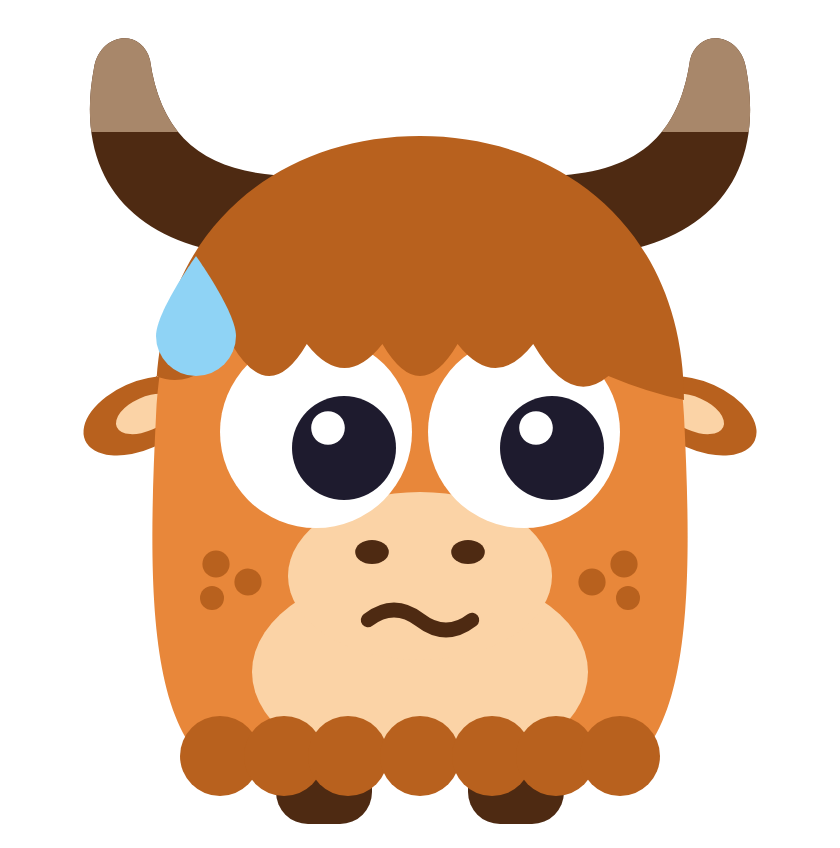
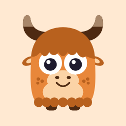
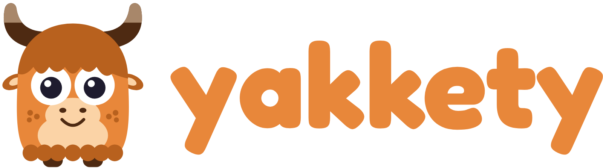

# Yakkety mascot



Yakkety is the AI Secretary of the NCSSM Young Alumni Council (YAC), and its mascot is a fun, friendly yak. The name comes from "yakkety yak" (chatter), and the yak gives us a character almost nobody in AI has.

Status: **v1, locked** (October 2026). Signature colour: **Toffee**.

## Quick start

| I need… | Use |
| --- | --- |
| Google Chat app or webhook avatar | `avatar/yakkety-avatar-512.png`, see [`docs/google-chat.md`](docs/google-chat.md) |
| Any other round profile picture | `avatar/yakkety-avatar-512.png` (or `avatar/yakkety-avatar-circle.svg` where nothing crops it) |
| App icon | `icon/png/yakkety-icon-512.png` (or `icon/yakkety-icon.svg`) |
| Logo for a header, signature or slide | `wordmark/yakkety-lockup-horizontal-light.svg` (or `-dark` on dark backgrounds) |
| Logo for a title slide, poster or square space | `wordmark/yakkety-lockup-stacked-light.svg` (or `-dark`) |
| The name on its own | `wordmark/yakkety-wordmark-toffee.svg` (`-chocolate` for small sizes, `-white` on dark) |
| iOS / Android icon (platform applies its own mask) | `icon/png/yakkety-icon-square-1024.png` |
| Website favicon | `icon/favicon.ico` plus `icon/png/yakkety-icon-180.png` as the Apple touch icon |
| Mascot in a slide, doc or UI | `svg/yakkety-<state>.svg` (transparent background) or `png/yakkety-<state>.png` |
| Colours | `tokens.json` |

```html
<link rel="icon" href="/favicon.ico" sizes="any">
<link rel="icon" href="/yakkety-icon.svg" type="image/svg+xml">
<link rel="apple-touch-icon" href="/yakkety-icon-180.png">
```

## The character

> A round, shaggy yak whose fringe flops over big, confident eyes, with two-tone horns that curl up like quotation marks for all that chatter, freckled cheeks and a wide, friendly smile.

The art follows the design language behind Duolingo's Duo, without copying Duo:

- Flat colour. No outlines, gradients or shadows.
- Built only from circles, ellipses and simple curves.
- The eyes take up about half the face and carry the emotion.
- One signature colour (Toffee) plus a few tints.
- A full set of expressions, and the mascot is the brand.

What keeps it ours, not Duo's:

- Toffee instead of green.
- A fringe over the eyes instead of Duo's eye shapes.
- Horns, ears and a shaggy fur hem give a different silhouette.
- Toffee freckles instead of blush.
- Fun and friendly, but not a baby face.

## Colour

| Token | Hex | Used for |
| --- | --- | --- |
| Toffee | `#E8873A` | Body. Yakkety's brand accent. |
| Toffee dark | `#B8611E` | Fringe, ears, fur hem, freckles |
| Apricot | `#FBD3A6` | Muzzle, belly, inner ears |
| Bone | `#A8876A` | Horn tips |
| Chocolate | `#4E2A12` | Horn bases, hooves, nostrils, mouth |
| Cream tile | `#FFE9D2` | Icon and avatar background |
| Ink | `#1E1B2E` | Pupils, closed eyes, speech bubble |

`#F27B8E` (tongue) and `#8FD3F5` (sweat drop) appear only in the Done and Oops expressions.

## Expressions

| | State | When to use it |
| --- | --- | --- |
|  | `idle` | Default face in chat and on the home screen |
|  | `thinking` | Working on a task. Eyes drift up, with thought dots. |
|  | `done` | Task finished. The one big-joy face; save it for real wins. |
|  | `needs-you` | Waiting on a decision or an approval |
|  | `oops` | Something failed. Honest, not dramatic. |

Every state changes only the eyes, the mouth and one small extra (thought dots, a "!" bubble or a sweat drop). The body, horns, fringe and freckles never change, which keeps Yakkety recognisable.

## App icon

   

- The icon is the **whole mascot**, horns to hooves, centred on the cream tile with space on every side. It is never cropped and never a separate head drawing, so it always matches the character.
- `yakkety-icon.svg` has its own rounded corners (23% radius). `yakkety-icon-square.svg` is full-bleed for platforms that mask icons themselves.
- At 16px the face details merge, but the horns, fringe and eyes still read as Yakkety.

## Avatar



For places that show Yakkety as a round profile picture: Google Chat, the Yaktion Items board, and any future integrations.

- The avatar is the same full-body yak on the cream background, with extra margin so a circular crop never clips the horns or hooves. It reads as Yakkety down to 24px.
- `yakkety-avatar-{256,512,1024}.png` and `yakkety-avatar.svg` are square; the platform applies the circle. Google Chat needs at least 256×256.
- `yakkety-avatar-circle.svg` draws its own circle, for places that show the image as is.
- **Where it's used:** Yaktion Items embeds it in the board (`src/Board.html`, next to Yakkety's comments). Google Chat setup is in [`docs/google-chat.md`](docs/google-chat.md).

## Wordmark



The wordmark is **"yakkety" in lowercase**, set in [Fredoka](https://github.com/google/fonts/tree/main/ofl/fredoka) Bold and converted to outlines. Its rounded letters match the mascot's soft, chunky shapes, and the mascot carries the yak idea, so the word stays simple. In running text, the name is still written **Yakkety**, with a capital Y and two k's.

| File | Use it on |
| --- | --- |
| `yakkety-wordmark-toffee` | White or light neutrals. The default. |
| `yakkety-wordmark-chocolate` | The cream tile, and anywhere the name is under about 24px tall, where toffee gets too light to read |
| `yakkety-wordmark-white` | Dark backgrounds, photos with a dark area, or a Toffee background |
| `yakkety-lockup-horizontal-light` / `-dark` | Headers, email signatures, slide footers |
| `yakkety-lockup-stacked-light` / `-dark` | Title slides, posters, square spaces |

Every file is in `wordmark/` as SVG, with 1600px-wide PNGs in `wordmark/png/`.

- **Dark lockups** put the mascot on its cream circle and use the white wordmark. On a dark background the mascot's chocolate horns and hooves disappear, so never put the bare mascot there.
- **Lockup proportions are fixed.** Don't move, resize or swap the mascot and the wordmark separately. Use the files as they are.
- **Clear space:** leave at least the height of the "a" on every side of the wordmark or lockup.
- **Minimum size:** wordmark 16px tall; horizontal lockup 32px tall; stacked lockup 64px tall. Below that, use the app icon instead.
- **Don't** recolour the wordmark beyond these three colours, set it in a different font, capitalise it, add effects, or retype it in Fredoka. Always use the files, which keep the exact letter spacing.

## Usage rules

**Do**
- Put the mascot on white, the cream tile, or light neutrals.
- Keep at least a quarter of the mascot's width as clear space around it.
- Use the expression that matches what Yakkety is actually doing.
- Keep the personality in the art and the copy. Yakkety appears when it has something to say, never as an unprompted pop-up (the Clippy lesson).

**Don't**
- Recolour it. Indigo, Berry and Highland Charcoal were explored and retired.
- Add outlines, gradients, drop shadows or 3D effects.
- Stretch, squash, rotate or crop it (the icon included).
- Add props. A pencil was tried and dropped because it looked odd.
- Put it on busy photos or on Toffee-orange backgrounds, where the body disappears.
- Put it in suggestive, mean or off-brand situations, or make it look babyish.

## Editing the art

All art comes from one file, [`src/yakkety.mjs`](src/yakkety.mjs). Change it there, then rebuild:

```bash
cd yakkety-mascot
node scripts/build.mjs           # SVGs only, no dependencies
npm install && npm run build     # SVGs, PNGs and favicon.ico (uses Playwright)
```

The wordmark's letter shapes are saved in `src/wordmark-data.mjs`, so builds don't need the font. To change the lettering, see `scripts/outline-wordmark.py`.

## How we got here

| Decision | Why |
| --- | --- |
| A yak | Puns on "Yakkety". Ownable, since no AI product uses one. |
| Duo-style flat character | The team loved Duo; it is the best-studied tech mascot. We borrow the rules, not the owl. |
| Toffee | Warm, true to a real yak's coat, and far from both Duo's green and the generic purple-blue "AI gradient" |
| Pencil prop removed | It looked odd wedged into a horn, and Duo works without props |
| Two-tone horns, dark base with bone tips | Cream horns vanished against the cream tile. Real yak horns are dark with paler tips. |
| Full-body icon with margin | A head-only crop looked rounder than the mascot, and a chest crop sat flush with the bottom edge |
| Toffee freckles | Translucent pink blush looked muddy, and solid rose read as too feminine. Freckles read as a friendly outdoor animal. |
| Lowercase "yakkety" wordmark in Fredoka Bold | Chosen over a capital Y drawn as horns: next to the mascot the plain lowercase is cleaner, and it holds up at small sizes and on dark backgrounds. Nunito and Baloo 2 were also tried; Fredoka matched the mascot best. |

Background research is in [`docs/research.md`](docs/research.md). The wordmark options we compared are in [`docs/wordmark-options.html`](docs/wordmark-options.html). [`docs/concept-sheet.html`](docs/concept-sheet.html) is the interactive concept sheet used during the design rounds; the colourway switcher on it shows retired options.
